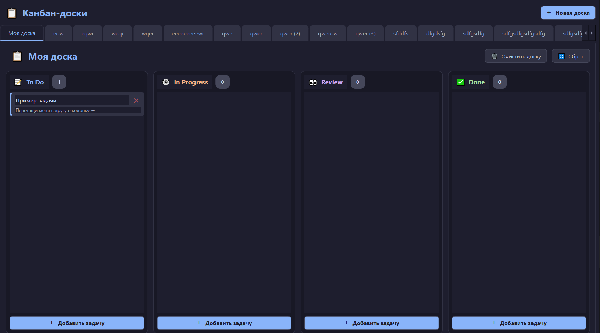
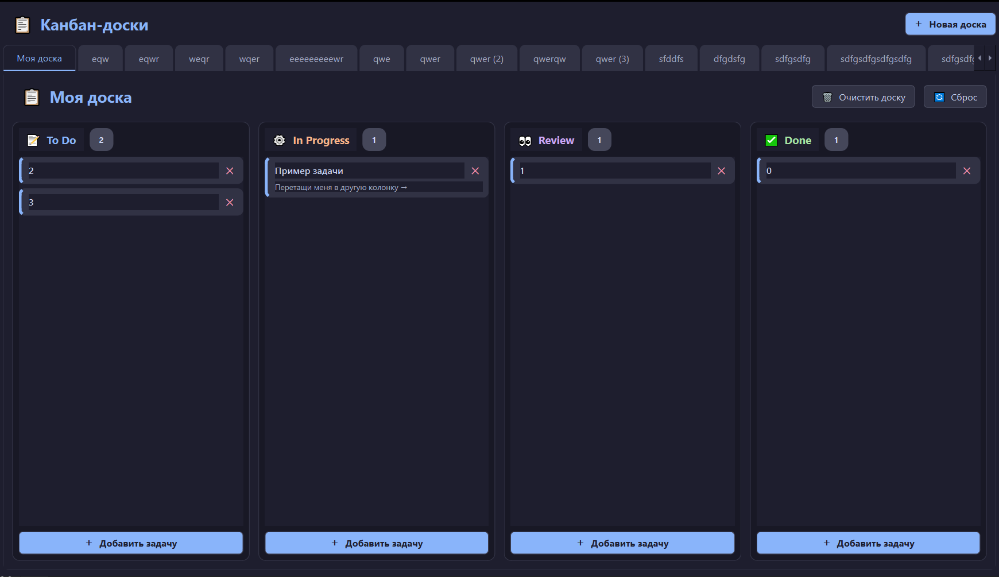

# 📋 Kanban Desk SQL

Удобное и быстрое десктопное приложение для управления задачами в стиле Kanban. Работает полностью офлайн, не требует настройки серверов и хранит все данные локально в базе SQLite.

[](https://www.python.org/)
[](https://pypi.org/project/PyQt6/)
[](https://www.sqlite.org/)

## ✨ Возможности

- **Мультидоски:** создавайте неограниченное количество досок (вкладок) для разных проектов.
- **Удобное перетаскивание (Drag & Drop):** просто зажмите карточку мышью и перенесите её в нужную колонку.
- **Управление задачами:** добавляйте, редактируйте (двойной клик) и удаляйте карточки.
- **Автосохранение:** все изменения мгновенно записываются в базу данных `kanban.db`.
- **Современный дизайн:** приятная глазу тёмная тема, плавные анимации и понятный интерфейс.
- **Полностью офлайн:** никакой регистрации, интернета и внешних серверов.

## 🖼 Скриншоты

### Главное окно с задачами


### Перетаскивание задачи (Drag & Drop)


## 🚀 Установка и запуск

Для запуска приложения вам понадобится установленный **Python 3.10 или выше**.

1. **Склонируйте репозиторий:**

   ```bash
   git clone https://github.com/coder-v1be/kanban-desk-sql.git
   cd kanban-desk-sql
   ```

2. **Создайте и активируйте виртуальное окружение (рекомендуется):**

   ```bash
   python -m venv .venv
   ```

   **Windows:**

   ```bash
   .venv\Scripts\activate
   ```

   **Linux / macOS:**

   ```bash
   source .venv/bin/activate
   ```

3. **Установите зависимости:**

   ```bash
   pip install --upgrade pip
   pip install PyQt6
   ```

   Если в репозитории есть файл `requirements.txt`, используйте:

   ```bash
   pip install -r requirements.txt
   ```

4. **Запустите приложение:**

   ```bash
   python main.py
   ```

> При первом запуске рядом с приложением автоматически создаётся файл базы данных `kanban.db`.

Для Windows также можно скачать готовый `.exe` из раздела **Releases** *(добавьте ссылку после публикации сборки)*.

## 🧭 Как пользоваться

1. Создайте новую доску для проекта.
2. Добавьте задачи в нужные колонки: `Todo`, `In Progress`, `Review`, `Done`.
3. Перетаскивайте карточки между колонками — изменения сохраняются автоматически.
4. Двойной клик по карточке открывает окно редактирования.
5. Удаление досок и задач выполняется через интерфейс с подтверждением действия.

## 🗃 Хранение данных

Все данные хранятся локально в файле `kanban.db` (SQLite). Приложение не отправляет данные в сеть.

Для резервной копии достаточно закрыть приложение и скопировать файл `kanban.db` в надёжное место.

## 🛠 Сборка в `.exe`

Установите PyInstaller:

```bash
pip install pyinstaller
```

Соберите приложение:

```bash
pyinstaller --noconfirm --onefile --windowed --name KanbanDeskSQL main.py
```

Готовый файл появится в папке `dist/`.  
Сборку под Windows рекомендуется выполнять на Windows.

## 🧱 Технологии

| Компонент | Технология |
|---|---|
| Язык программирования | Python 3.10+ |
| GUI-фреймворк | PyQt6 |
| База данных | SQLite3 |
| Сборка | PyInstaller |

## 📁 Структура проекта

```text
kanban-desk-sql/
├── main.py           # Точка входа, инициализация БД и запуск приложения
├── database.py       # Класс Database: SQL-запросы, миграции, создание таблиц
├── window.py         # Главное окно KanbanWindow, управление вкладками досок
├── dialogs.py        # Диалоговое окно создания/редактирования задачи
├── style.py          # QSS-стили для тёмной темы
└── widgets/          # Кастомные виджеты
    ├── board.py      # Виджет одной доски
    ├── column.py     # Виджет колонки
    └── task_card.py  # Карточка задачи с реализацией Drag & Drop
```

## 📄 Лицензия

Проект создан в образовательных целях. Распространяется под лицензией MIT.
