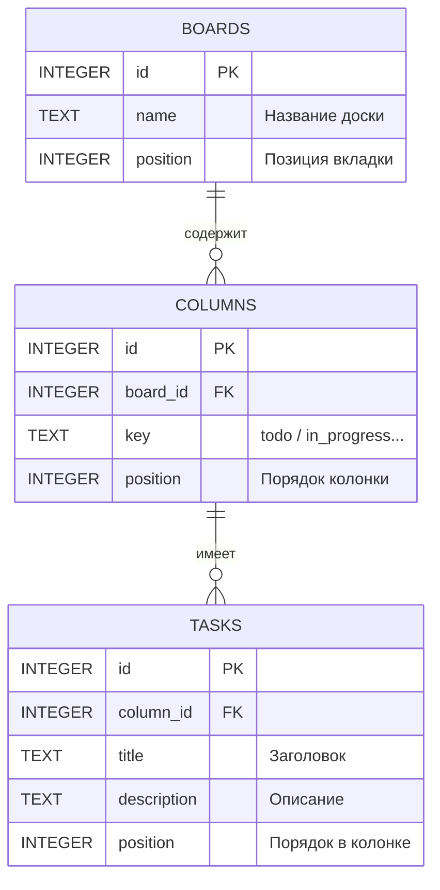
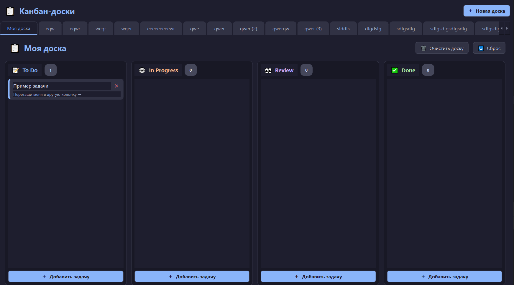
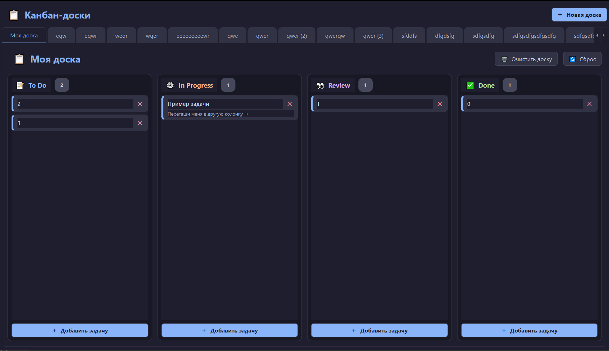

# 📋 Kanban Board на PyQt6 + SQLite

Десктопное приложение «Канбан-доска» с современным тёмным интерфейсом. Поддерживает создание нескольких досок (вкладок), Drag & Drop для карточек задач, а также надёжное сохранение данных в локальную базу SQLite.

## 📌 О проекте

* **Название проекта:** Kanban Board (GUI-приложение)
* **Технологии:** Python 3.10+, PyQt6, SQLite3
* **Тип приложения:** Десктопное GUI-приложение
* **Среда разработки:** PyCharm / VS Code

## ✨ Функционал

### Обязательный функционал (MVP)
* **Мультидоски:** Создание, переименование (двойной клик по вкладке) и закрытие неограниченного количества досок.
* **Колонки:** Фиксированные статусы (`To Do`, `In Progress`, `Review`, `Done`).
* **Drag & Drop:** Плавное перетаскивание карточек задач между колонками с автоматическим сохранением.
* **SQLite база данных:** Все доски, колонки и задачи сохраняются в локальный файл `kanban.db`. Данные не теряются при перезапуске.
* **Управление задачами:** Добавление, редактирование и удаление карточек через диалоговое окно или контекстное меню (правый клик).
* **Очистка и сброс:** Удаление всех задач на доске или заполнение демо-данными для быстрого старта.
* **Тёмная тема:** Современный дизайн в стиле Catppuccin Mocha, кастомные QSS-стили, скругления и анимации.

### Дополнительный функционал (Бонус)
* ✅ **Контекстные меню:** Управление вкладками и карточками по клику правой кнопкой мыши.
* ✅ **Сохранение позиций:** Порядок карточек внутри колонок и порядок самих досок сохраняется в БД (поле `position`).
* ✅ **Кастомный Drag Pixmap:** При перетаскивании создается полупрозрачная копия карточки.
* *Опционально (идеи):* Приоритеты задач (цветовая индикация), дедлайны, экспорт в CSV.

## 🏗 Архитектура проекта

Код разделен на слои для соответствия требованиям (отделение логики работы с данными от интерфейса). Каждый модуль отвечает за свою зону ответственности.

```text
kanban-project/
│
├── main.py              # Точка входа в приложение (запуск окна)
├── database.py          # Работа с SQLite (класс Database, схема БД, CRUD)
├── style.py             # QSS-стили для тёмной темы
├── dialogs.py           # Диалоговое окно создания/редактирования задачи
├── window.py            # Главное окно (класс KanbanWindow, управление вкладками)
│
└── widgets/             # Пользовательские виджеты
    ├── __init__.py
    ├── board.py         # BoardWidget — одна доска (вкладка)
    ├── column.py        # Column — колонка с задачами
    └── task_card.py     # TaskCard — карточка задачи + логика Drag & Drop
```
## 🗄 Схема базы данных

Приложение использует локальную базу данных SQLite. Связи между таблицами построены по принципу «Один ко многим» (One-to-Many) с использованием внешних ключей (`FOREIGN KEY`) и каскадным удалением (`ON DELETE CASCADE`).


# 🚀 Установка и запуск
Клонируйте репозиторий (или распакуйте архив):

bash
git clone https://github.com/coder_v1be/kanban-board.git
cd kanban-board
Создайте и активируйте виртуальное окружение:
**powershell**
## Windows (PowerShell)
```text
python -m venv .venv
.venv\Scripts\Activate.ps1
```
## macOS / Linux
```text
python3 -m venv .venv
source .venv/bin/activate
Установите зависимости:

bash
python -m pip install --upgrade pip
python -m pip install PyQt6
(Если есть файл requirements.txt, используйте pip install -r requirements.txt)
```
## Запустите приложение:

bash
**python main.py**
⚠️ **Важно**: запускать нужно именно main.py, а не window.py. Точка входа проекта находится в main.py.

# ⌨️ Управление
**Действие** → **Как вызвать**

Добавить задачу	Кнопка «＋ Добавить задачу» в колонке

Редактировать задачу	Двойной клик / правый клик → «✏ Редактировать»

Удалить задачу	Крестик на карточке / правый клик → «🗑 Удалить»

Переместить задачу	Зажать карточку и перетащить в другую колонку

Новая доска	Кнопка «＋ Новая доска» сверху

Переименовать доску	Двойной клик по вкладке / правый клик по вкладке

Закрыть доску	Правый клик по вкладке → «✕ Закрыть доску»

Очистить доску	Кнопка «🗑 Очистить доску»

Загрузить демо	Кнопка «🔄 Сброс»

# 🖼 Скриншоты

### Главное окно с задачами


### Перетаскивание задачи (Drag & Drop)



# Установите PyInstaller:

bash
``` install pyinstaller ```
Выполните сборку из корневой папки проекта:

bash
```pyinstaller --noconfirm --onefile --windowed --name="KanbanBoard" main.py```
Готовый файл KanbanBoard.exe появится в папке dist/.

# 📋 Критерии приёмки
☑ Приложение запускается без ошибок.

☑ Поддерживается создание нескольких досок (вкладок).

☑ Работает Drag & Drop между колонками с сохранением в БД.

☑ Все данные сохраняются в SQLite (проверено перезапуском).

☑ Код соответствует PEP 8, логика отделена от UI (модульная архитектура).

☑ Есть README с инструкцией запуска.

# 📝 Лицензия
Проект создан в образовательных целях. Распространяется под лицензией MIT.
