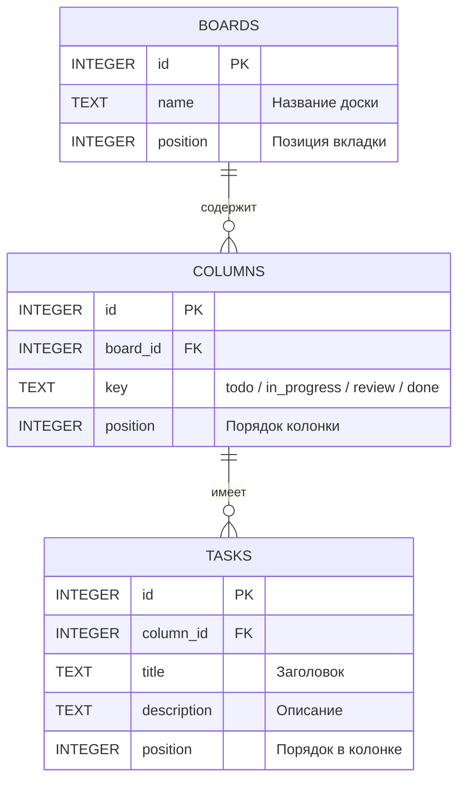

# 📑 Отчет по разработке проекта «Kanban Desk SQL»

**Автор:** Бородько Маргарита
**Ссылка на репозиторий:** [coder-v1be/kanban-desk-sql](https://github.com/coder-v1be/kanban-desk-sql)  
**Дата:** Ноябрь 2026 г.

---

## Содержание

1. [Введение](#1-введение)
2. [Используемые технологии](#2-используемые-технологии)
3. [Архитектура проекта](#3-архитектура-проекта)
4. [Схема базы данных](#4-схема-базы-данных)
5. [Реализация ключевого функционала](#5-реализация-ключевого-функционала)
6. [Выводы](#6-выводы)

---

## 1. Введение

**Цель проекта:** разработка десктопного приложения для управления задачами по методологии Kanban.

**Актуальность:** существующие веб-решения, такие как Trello и Jira, требуют постоянного подключения к интернету и регистрации. Разработанное приложение работает полностью офлайн, обеспечивает конфиденциальность данных и не нагружает операционную систему.

---

## 2. Используемые технологии

| Компонент | Технология | Назначение |
|---|---|---|
| Язык программирования | Python 3.10+ | Основной язык разработки |
| GUI-фреймворк | PyQt6 | Кроссплатформенность и нативный внешний вид |
| СУБД | SQLite3 | Встроенная библиотека, не требует установки отдельного сервера |
| Сборка | PyInstaller | Создание независимых `.exe` файлов |

---

## 3. Архитектура проекта

Проект спроектирован с использованием модульного подхода. Логика работы с данными строго отделена от пользовательского интерфейса.

### Структура файлов

```text
kanban-desk-sql/
├── main.py           # Точка входа, инициализация БД и запуск приложения
├── database.py       # Класс Database: SQL-запросы, миграции, создание таблиц
├── window.py         # Главное окно KanbanWindow, управление вкладками досок
├── dialogs.py        # Диалоговое окно создания/редактирования задачи
├── style.py          # QSS-стили для темной темы
└── widgets/          # Кастомные виджеты
    ├── board.py      # Виджет одной доски
    ├── column.py     # Виджет колонки
    └── task_card.py  # Карточка задачи с реализацией Drag & Drop
```

---

## 4. Схема базы данных

Для хранения данных используется реляционная база данных SQLite. Связи построены по принципу «Один ко многим» с использованием каскадного удаления.



> **ON DELETE CASCADE:** при удалении доски автоматически удаляются все её колонки и задачи, что исключает появление «осиротевших» записей.

> **Поле `position`:** позволяет сохранять порядок карточек внутри колонок и порядок самих досок после перезапуска приложения.

---

## 5. Реализация ключевого функционала

### 5.1. Drag & Drop (перетаскивание)

Механизм реализован в классе `TaskCard` путём переопределения событий мыши:

- в `mouseMoveEvent` создаётся объект `QDrag` и `QPixmap` — полупрозрачная копия карточки;
- в классе `Column` переопределён метод `dropEvent`. При отпускании мыши программа определяет, в какую колонку упала карточка, и отправляет SQL-запрос `UPDATE tasks SET column_id = ?`, мгновенно сохраняя изменения в БД.

### 5.2. Пользовательский интерфейс

- Использована кастомная тёмная тема **Catppuccin Mocha** через QSS.
- Реализованы интерактивные элементы: при наведении на карточку или кнопку меняется цвет фона.
- Для ввода данных используются модальные окна `QDialog`.

### 5.3. Обработка ошибок

- Подключение к БД обёрнуто в блоки `try/except`.
- Включён режим `PRAGMA foreign_keys = ON` для корректной работы связей.
- Все действия пользователя, например удаление доски, требуют подтверждения через `QMessageBox`.

---

## 6. Выводы

В ходе работы было создано стабильное десктопное приложение. Код соответствует стандарту **PEP 8**, логика отделена от интерфейса — использован MVC-подобный подход. Приложение готово к использованию и дальнейшему масштабированию. Осуществлена сборка в независимый исполняемый файл.